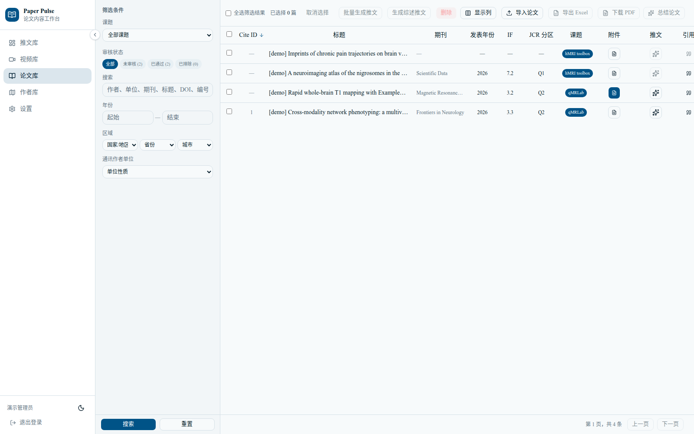
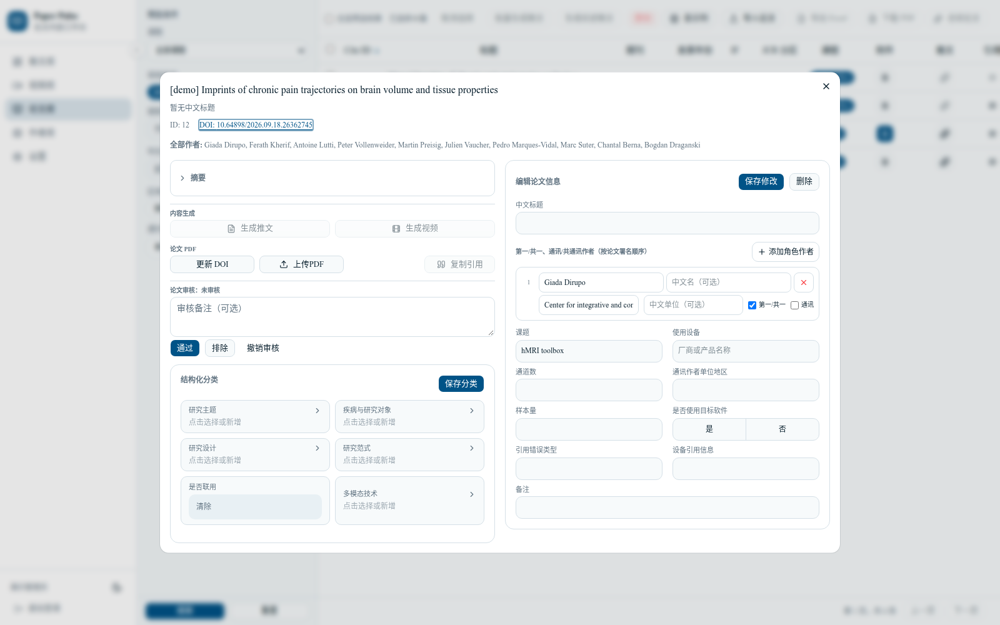
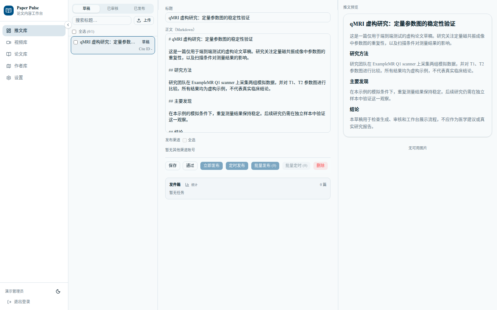
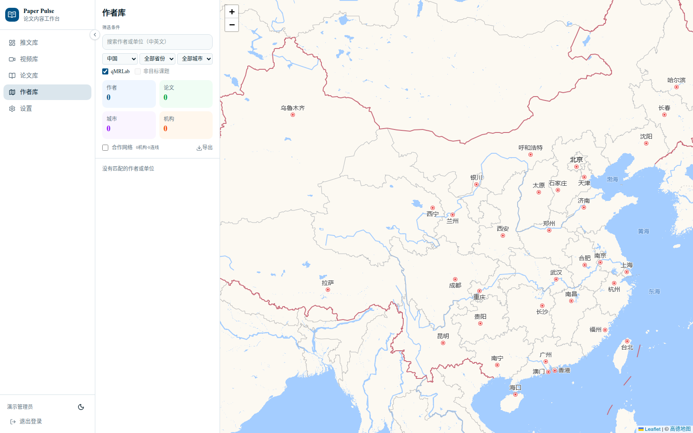
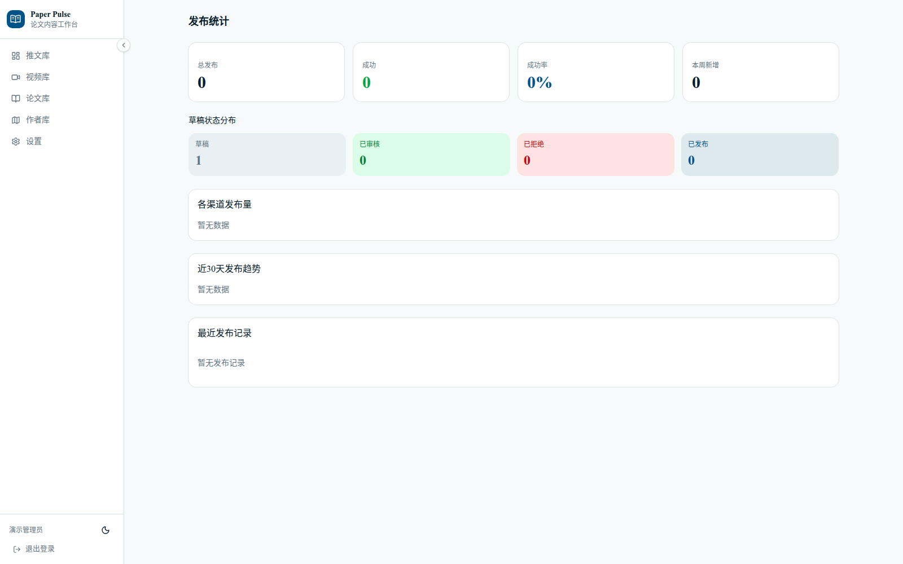
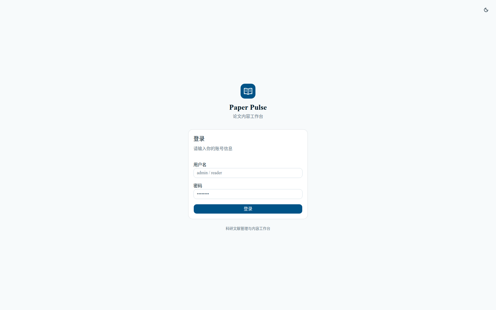

# Paper Pulse

[](https://github.com/zuooonz/paper-pulse/actions/workflows/ci.yml)　[](https://zuooonz.github.io/paper-pulse/)

一个可配置的学术论文研究与内容工作台：论文库、作者与机构地图、PDF/元数据补全、草稿生成与审核、异步任务和发布队列。领域检索词、课题目录、分类词表、提示词和发布渠道都由配置驱动，仓库内提供通用示例。

> **在线演示**：<https://zuooonz.github.io/paper-pulse/>
>
> 演示站使用真实 React 前端组件和静态 API fixtures，包含 4 篇 `[demo]` 论文；只读，不连接后端、登录或真实 PDF。完整应用请按下方说明自部署。



## 功能

- **论文库**：按审核状态、课题、作者单位、年份、分类和关键词筛选；列表列可配置，支持 Excel 导出、批量选择和论文详情。
- **论文生命周期**：处理状态（pending/processing/done/failed）、人工审核（unreviewed/approved/excluded）、PDF 可用性和元数据完整度分别记录；只有处理完成、审核通过且符合课题范围的论文可以生成内容。
- **作者库**：作者/机构搜索、地理分布地图、单位与省份统计，以及作者资料维护。
- **导入与补全**：DOI 导入、文献检索、批量 PDF 导入；通过 Crossref、PubMed 等来源补充元数据，并使用本地 JCR/中科院参考数据匹配期刊指标。
- **PDF 处理**：上传或下载 PDF，本地提取文本和图片；提供签名临时下载链接，不把真实 PDF 放进演示仓库。
- **草稿工作流**：调用 OpenAI Chat Completions 兼容模型生成中文草稿，支持编辑、审核、评分和预览。
- **异步任务**：数据库持久化队列；独立 worker 执行检索、下载、生成和发布任务，调度器通过租约避免重复调度。
- **内容发布**：通过已配置的公众号/平台账号和浏览器自动化或 API 适配器发布；发布记录可追踪。
- **治理与安全**：角色权限、对象级可见性、配额、审计日志、登录限流、JWT 版本轮换、httpOnly NextAuth 会话和只读演示模式。

## 使用边界

- **自托管工具**：项目不提供托管服务、账号体系或公共数据共享；论文、PDF、生成内容和发布凭据由部署者自行管理。
- **发布渠道**：浏览器自动化渠道只应用于你有权操作的账号；平台条款、频率限制和账号风险由使用者自行承担。程序不会绕过验证码或安全验证。
- **内容责任**：模型只生成待人工核验的草稿；审核、引用、医学表述和最终发布由人负责。
- **演示数据**：公开演示只包含 4 篇 `[demo]` 论文的书目/作者/审核元数据和 1 个合成 PDF，不包含真实 PDF、摘要或全文。

## 截图

| 论文库 | 论文详情 | 工作台 |
| --- | --- | --- |
|  |  |  |

| 作者库 | 发布统计 | 登录 |
| --- | --- | --- |
|  |  |  |

## 架构

```text
┌────────────────────┐        HTTP/JSON        ┌────────────────────┐
│ Next.js 网页应用    │ ──────────────────────▶ │ FastAPI API        │
│ App Router + RSC   │                         │ 认证 / 论文 / 草稿  │
└────────────────────┘                         └─────────┬──────────┘
                                                        │
                    ┌───────────────────────────────────┼───────────────────┐
                    ▼                                   ▼                   ▼
             SQLite / PostgreSQL                 共享文件存储         数据库任务队列
             Paper / Author / Draft              PDF / 图片 / 导出      worker + scheduler
```

- `frontend/`：Next.js 16、React 19、TanStack Query、Tailwind CSS。
- `src/api/`：FastAPI 路由、认证、论文/作者/草稿/视频/治理接口。
- `src/paper_library/`：SQLAlchemy 模型、查询、生命周期和迁移。
- `src/worker/`：队列消费、任务注册、调度器与保留清理。
- `src/publisher/`：各发布渠道适配器。
- `migrations/`：Alembic 迁移；`data/reference/`：带独立许可的期刊参考数据。

更细的模块说明见 [docs/ARCHITECTURE.md](docs/ARCHITECTURE.md)。

## 快速开始

### Docker Compose（推荐）

要求 Docker Engine 24+ 和 Docker Compose v2。

```bash
git clone https://github.com/zuooonz/paper-pulse.git
cd paper-pulse
cp .env.example .env
```

编辑 `.env`，至少设置：

- `JWT_SECRET`：随机长字符串；
- `AUTH_SECRET`：NextAuth 会话签名密钥，不能与 JWT secret 相同；
- 用户：设置 `LOCAL_USERS` JSON，或直接填写 `LOCAL_ADMIN_PASSWORD`、`LOCAL_REVIEWER_PASSWORD`、`LOCAL_VIEWER_PASSWORD`、`LOCAL_LIMITED_PASSWORD`。密码必须是 `python -m api.hash_password` 生成的 PBKDF2 哈希；生产环境保持 `ALLOW_PLAINTEXT_PASSWORDS=false`。

生成密码哈希：

```bash
python -m venv .venv
source .venv/bin/activate
python -m pip install -e ".[dev]"
PYTHONPATH=src python -m api.hash_password
```

启动：

```bash
docker compose up --build
```

网页：<http://localhost:3000>　API 文档：<http://localhost:8000/docs>　健康检查：`/healthz`

可选写入公开演示库（4 篇 `[demo]` 论文）：

```bash
docker compose exec api python scripts/seed_demo_library.py --reset
```

使用 PostgreSQL：

```bash
docker compose --profile postgres up -d db
# 等 db 健康后，在 .env 设置 DATABASE_URL：
# postgresql+psycopg://paper_pulse:<password>@db:5432/paper_pulse
docker compose --profile postgres up --build
```

扩展 worker：

```bash
docker compose up --build --scale worker=3
```

浏览器自动化发布渠道需要构建带 Chromium 的镜像：`INSTALL_PLAYWRIGHT=true docker compose build`。

### 本地开发

要求 Python 3.11+、Node.js 22+ 和 npm。

```bash
cp .env.example .env
cp config/runtime.example.yaml config/runtime.yaml
cp frontend/.env.example frontend/.env.local

python -m venv .venv
source .venv/bin/activate
python -m pip install -e ".[dev,postgres]"

set -a
. ./.env
set +a
PYTHONPATH=src uvicorn api.main:app --reload --timeout-keep-alive 75
```

另开终端启动 worker 和调度器（或设置 `JOBS_INLINE=true`、`RUN_SCHEDULER_IN_API=true` 使用单进程模式）：

```bash
set -a; . ./.env; set +a
PYTHONPATH=src python -m worker --concurrency 1
```

```bash
set -a; . ./.env; set +a
PYTHONPATH=src python -m worker.scheduler
```

前端：

```bash
cd frontend
npm ci
npm run dev
```

打开 <http://localhost:3000>。`frontend/.env.local` 中的 `AUTH_SECRET`/`NEXTAUTH_SECRET`、`BACKEND_API_URL` 和 `NEXT_PUBLIC_API_URL` 按需调整；详见 [frontend/README.md](frontend/README.md)。

### 演示数据

公开演示库由 [scripts/demo_library.json](scripts/demo_library.json) 和 [scripts/seed_demo_library.py](scripts/seed_demo_library.py) 组成：

```bash
python scripts/seed_demo_library.py --reset
```

它只保留 4 篇 `[demo]` 论文的书目/作者/审核等元数据，不包含真实 PDF、摘要或全文；只为其中一个条目生成合成占位 PDF。`scripts/seed_demo_data.py` 仍保留为 24 篇全合成演示数据的开发/测试工具。

### 静态前端演示

GitHub Pages 构建的是真实前端组件，而不是手写截图页：

```bash
cd frontend
npm ci
npm run demo:build
```

构建结果是 `frontend/demo-dist`。演示模式把 API 请求映射到 `frontend/demo/fixtures/` 的静态响应，使用真实页面、筛选、详情和布局代码，禁用写操作；不启动 FastAPI、数据库或 NextAuth。Pages 工作流见 [.github/workflows/pages.yml](.github/workflows/pages.yml)。

## 配置

`.env.example` 是完整模板，常用变量：

| 变量 | 用途 |
| --- | --- |
| `JWT_SECRET`、`JWT_TOKEN_VERSION` | API JWT 签名密钥与 token 版本；递增版本可让旧 token 立即失效 |
| `AUTH_SECRET`、`NEXTAUTH_SECRET`、`NEXTAUTH_URL` | NextAuth 会话签名与前端来源 |
| `LOCAL_USERS`、`LOCAL_*_PASSWORD` | 本地用户及 PBKDF2 密码哈希；Docker/Compose 推荐使用后者 |
| `ALLOW_PLAINTEXT_PASSWORDS` | 明文密码兼容，默认关闭；生产环境不要开启 |
| `DATABASE_URL` | 统一数据库；SQLite 默认，生产建议 PostgreSQL |
| `DB_POOL_SIZE`、`DB_MAX_OVERFLOW`、`DB_STATEMENT_TIMEOUT_MS` | 连接池与 PostgreSQL 语句超时 |
| `LLM_BASE_URL`、`LLM_API_KEY`、`LLM_MODEL` | OpenAI Chat Completions 兼容模型服务 |
| `CREDENTIALS_ENCRYPTION_KEY` | 发布渠道凭据的 Fernet 加密密钥；未设置时拒绝保存凭据 |
| `ALLOW_PRIVATE_NETWORK_DOWNLOADS` | 是否允许下载到内网地址，默认关闭 |
| `JOB_RETENTION_DAYS` | 终态任务保留天数，默认 30；0 关闭清理 |
| `PUBLISH_STUCK_MINUTES`、`WORKER_*`、`UVICORN_*` | 发布超时、worker 副本/并发和 API 进程配置 |
| `NEXT_PUBLIC_APP_TIMEZONE` | 前端日期显示时区，应与后端 `APP_TIMEZONE` 保持一致 |
| `STORAGE_ROOT`、`PDF_ROOT`、`OUTPUT_ROOT` | 数据、PDF 和生成文件目录 |
| `DINGTALK_*` | 可选钉钉 SSO；默认关闭，启用时需配置部门角色映射 |

完整说明见 [SECURITY.md](SECURITY.md) 和 [frontend/README.md](frontend/README.md)。

## 测试

```bash
# 后端
source .venv/bin/activate
PYTHONPATH=src python -m pytest -q
python -m ruff check src tests scripts

# 前端
cd frontend
npx tsc --noEmit
npm run lint
npm test
npm run build

# 静态演示构建
npm run demo:build
```

测试覆盖 API、论文生命周期、权限、配额、迁移、worker、导出和演示库种子。CI 还会运行 PostgreSQL 测试、前端构建和凭证扫描。

## 目录

| 路径 | 内容 |
| --- | --- |
| `src/api/` | FastAPI 应用、路由、认证和依赖 |
| `src/core/` | 领域配置、模型客户端、文献元数据 |
| `src/paper_library/` | 数据库模型、论文/作者/期刊服务、迁移支持 |
| `src/worker/`、`src/publisher/` | 持久化队列、worker、调度器、发布渠道 |
| `frontend/` | Next.js 前端；`frontend/demo/` 是 Pages 静态演示入口 |
| `config/` | 领域包、课题目录、分类、导入、发布和运行时示例 |
| `migrations/` | Alembic 迁移 |
| `scripts/` | 演示库、维护、迁移和导入脚本 |
| `tests/`、`e2e/` | 后端测试、端到端/走查和压测 |
| `docs/` | 截图、架构和演示说明 |

## 隐私与脱敏

不要提交 `.env`、`frontend/.env.local`、`config/runtime.yaml`、密码哈希、Cookie、服务令牌或真实论文 PDF。公开截图和演示数据应使用 `[demo]` 前缀，并移除个人信息、机构内部信息和出版商全文。`scripts/demo_library.json` 只保留书目/作者/审核元数据；公开前请再运行 `local/private_scan.sh` 或仓库 CI 的凭证扫描。

## 常见问题

- **登录后立即 401 / 无法进入**：检查 `.env` 是否设置 `JWT_SECRET` 和 `AUTH_SECRET`，以及用户密码是否为 PBKDF2 哈希且 `ALLOW_PLAINTEXT_PASSWORDS=false`；修改后重启 API 和网页。
- **演示站为什么不能导入/发布**：GitHub Pages 只托管静态文件；演示模式完全在浏览器里渲染真实前端组件，写操作被禁用。完整功能需要按“快速开始”启动 API、worker 和数据库。
- **论文列表为空或筛选不到**：确认论文已处理完成并通过审核；论文库默认只显示“已通过”，可在审核状态中选择“全部”。演示站已预先切换到全部状态。
- **PDF/摘要为什么不在演示仓库**：出于版权、隐私和仓库体积考虑，公开演示只保留书目/作者元数据和 1 个合成 PDF；真实文件应保存在自部署的共享卷。

## 安全与已知限制

- 不要提交 `.env`、`frontend/.env.local`、`config/runtime.yaml`、密码哈希、Cookie、服务令牌或真实 PDF。
- 登录限流是单进程保护；公网多 worker 部署应在反向代理/网关再加限流。
- 论文搜索使用单库 SQL `LIKE`；大规模论文库需要外部搜索或索引表。
- 浏览器自动化发布渠道可能随平台页面变化失效，使用前请核对平台条款。
- GitHub Pages 只提供只读静态演示；完整前后端、登录、任务和发布必须自部署。
- `docs/screenshots/` 是当前版本截图；演示站由真实前端组件构建，不是截图。

## 许可

项目代码采用 MIT 许可，见 [LICENSE](LICENSE)。`data/reference/` 中的期刊参考数据按 GPL-3.0 再分发，来源和许可见 [data/reference/NOTICE.md](data/reference/NOTICE.md)。
